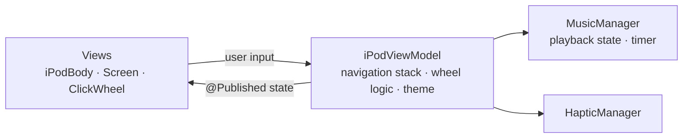

# iPod Classic iOS

A nostalgic recreation of the **iPod Classic (5th generation)** interface for iPhone, built entirely in **SwiftUI**. Scroll through menus with a working click wheel, feel haptic ticks on every step and browse music and photos just like on the original device.

### Highlights

- **Working click wheel:** circular drag gesture converted into menu scrolling, with angle tracking and tick thresholds
- **Haptic feedback:** separate light, medium and rigid haptics for scrolling, selecting and going back
- **Authentic navigation:** stack-based screen flow with slide animations and a MENU button to go back
- **Now Playing:** play/pause, next/previous, progress bar and auto-advance to the next track
- **Music library:** browse by Playlists, Artists, Albums and Songs
- **Photos:** 3-column grid, full-screen view and photo browsing with the wheel buttons
- **5 color themes:** Classic, Midnight, Rose, Forest and Sunset

## Architecture

The app follows **MVVM**: views stay declarative, and all navigation and wheel logic lives in a single view model.



- **Models:** `iPodScreen`, `MenuItem`, `iPodTheme`, `MusicManager`, `HapticManager`
- **ViewModel:** `iPodViewModel` manages the screen stack, selection index, wheel angle → menu tick conversion and theme
- **Views:** iPod body, screen, click wheel and one view per screen (menus, song/artist/album/playlist lists, Now Playing, Photos, Theme, About)

## How the Click Wheel Works

1. A `DragGesture` on the wheel reports the finger position.
2. The position is converted to an angle relative to the wheel's center.
3. The angle difference is normalized to the range −180°…180° and accumulated.
4. Every 30° of rotation moves the selection one row up or down and fires a haptic tick.

## Tech Stack

- Swift, SwiftUI
- Combine (`ObservableObject`, `@Published`, timer publisher)
- UIKit haptics (`UIImpactFeedbackGenerator`)
- `AsyncImage` for loading photos

## Requirements

- Xcode 26 or later
- iOS 26.2 or later (iPhone)

## Getting Started

```bash
git clone https://github.com/mrcanarda/ipod-classic-ios.git
cd ipod-classic-ios
open iPod.xcodeproj
```

Select an iPhone simulator or device and press **Run** (⌘R). For haptic feedback, run on a real device.

## Project Structure

```
iPod/
  Models/           # screens, menu items, themes, music and haptic managers
  ViewModels/       # iPodViewModel (navigation + click wheel logic)
  Views/
    Components/     # ClickWheelView, ScreenView, MenuRowView
    ...             # menus, lists, Now Playing, Photos, Theme, About
  iPodApp.swift
  ContentView.swift
```

## License

MIT
